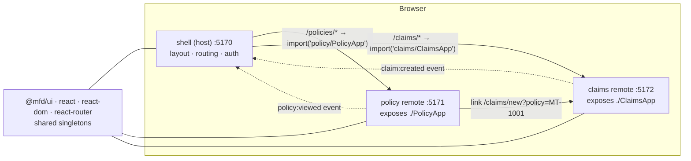

# Micro-frontend insurance portal

A small insurance portal split into independently built micro-frontends with
**Module Federation**, **Vite 8**, **React 19** and **TypeScript**.

- **shell** (host): layout, navigation and authentication. Loads the other apps at runtime.
- **policy** (remote): the policy team's app: policy list and details.
- **claims** (remote): the claims team's app: claim list and a first-notice-of-loss form.
- **@mfd/ui**: the shared design system (tokens and components), loaded once for everybody.
- **@mfd/contracts**: the public API between the apps: domain types, remote props and a typed event bus.

Each app can be developed, tested, built and deployed on its own. The shell never imports remote
code at build time; it fetches each remote's `remoteEntry.js` when the user opens that part of the
portal.

## Architecture



| Concern | Owner |
| --- | --- |
| Top-level URLs, layout, navigation, current user | shell |
| Everything under `/policies/*`, policy data | policy team |
| Everything under `/claims/*`, claim data | claims team |
| Tokens, components, formatting | `@mfd/ui` |
| Types, remote props, event names and payloads | `@mfd/contracts` |

## Getting started

Requires Node 22.12+ and pnpm (the version is pinned in `package.json`).

```bash
pnpm install
pnpm dev            # shell :5170, policy :5171, claims :5172
```

Open <http://localhost:5170>. The dashboard lists a few things to try.

```bash
pnpm build && pnpm preview          # the production builds of all three apps
pnpm --filter @mfd/policy dev       # one remote on its own (standalone mode)
pnpm check                          # lint + type-check + tests + build, same as CI
```

To see a remote fail, start only the shell and the policy remote, then open **Claims**:

```bash
pnpm --filter @mfd/shell --filter @mfd/policy --parallel dev
```

Start the claims remote afterwards (`pnpm --filter @mfd/claims dev`) and press **Try again**; it
loads without a page reload.

## Repository layout

```text
apps/
  shell/       host: Layout, RemoteModule (loading, timeout, error boundary, retry), event listeners
  policy/      remote exposing ./PolicyApp
  claims/      remote exposing ./ClaimsApp
packages/
  ui/          design tokens (CSS variables) and React components, CSS Modules
  contracts/   domain types, RemoteAppProps, typed event bus
tooling/
  federation.ts  ports and shared singletons used by every vite.config.ts
```

## Design decisions

**Route-based composition.** The shell maps URL prefixes to remotes (`/policies/*`, `/claims/*`).
Remotes render relative `<Routes>`, so the shell owns the top-level URL space and each team owns
everything below its prefix. Deep links, the back button and reloads work as in a single app.

**Shared singletons.** `react`, `react-dom`, `react-router` and `@mfd/ui` are shared with
`singleton: true` (see `tooling/federation.ts`). Two copies of React break hooks ("Invalid hook
call"), two routers cannot see each other's location and two design-system copies would inject the
same CSS twice. Each app's `package.json` range becomes its required version, so a mismatch is
reported at runtime. In the browser all three apps report these packages as coming `from: "shell"`.

**A contract package instead of shared code.** Apps never import each other. What they share is
`@mfd/contracts`: `RemoteAppProps` (the shell passes only the current user, because it owns
authentication), the domain types and `MfdEventMap`, the list of events and their payloads. The
types of the remote modules come from this package through `declare module` in the shell, so there
is no type-archive download at build time. The Module Federation `dts` plugin is the alternative
when teams live in separate repositories.

**Communication through URLs and events.** The policy app links to `/claims/new?policy=MT-1001`; the
URL is the whole contract between the two. The claims app emits `claim:created` and does not know who
listens; the shell turns it into a toast and a badge. The event bus is built on `window`
`CustomEvent`s and holds no module state, so it works even though each app bundles its own copy of
`@mfd/contracts`. There is no shared global store: each remote fetches its own data.

**Failure isolation.** `RemoteModule` wraps every remote in Suspense, an 8 second timeout and an
error boundary. A remote that is down, hangs or throws while rendering shows a message inside its
own area; the navigation and the other remotes keep working. **Try again** starts a fresh load.

**CSS isolation.** Components use CSS Modules (hashed class names per build). Design tokens are CSS
variables with an `--mfd-` prefix. `base.css` is global and only the shell, or a remote running
standalone, imports it; exposed modules never do, so a remote cannot restyle the host page.

**Per-environment remote URLs.** The shell reads `POLICY_REMOTE_ENTRY` and `CLAIMS_REMOTE_ENTRY`
(see `apps/shell/.env.example`) and falls back to the local servers. This fixes the URLs at build
time. To build once and deploy the same artifact to every environment, the shell would instead load
a small runtime manifest and register the remotes with `registerRemotes()` from
`@module-federation/runtime`.

**Supply chain.** `pnpm-workspace.yaml` sets `minimumReleaseAge` to 7 days, so a freshly published
(and possibly compromised) version never lands in the lockfile. CI installs with
`--frozen-lockfile`.

## Problems I ran into

These came up while building the demo; each one is covered by a test or a comment in the code.

- **React reused the remote across routes.** Both routes render `<RemoteModule>` in the same place,
  so navigating from Policies to Claims kept the policy instance and its already loaded module on
  screen under `/claims`. A `key` per route fixes it (`apps/shell/src/App.tsx`, test "swaps the
  remote when navigating").
- **No `lazy()` during render.** The React Compiler lint rule `static-components` rejects creating a
  component during render. `RemoteModule` keeps the load promise in state (created once per attempt)
  and reads it with React 19 `use()`; a retry creates a new promise.
- **No `setState` directly in an effect.** The rule `set-state-in-effect` flagged the loading state of
  the data hook. `useRequest` now derives "loading" during render from which request the last result
  belongs to.
- **Focusing the first invalid field.** Right after `setErrors`, `aria-invalid` is not in the DOM yet,
  so the form focuses the field by name instead (the test caught this).
- **Testing Suspense in React 19.** Components that suspend with `use()` must be rendered inside an
  awaited `act()`; otherwise the test never sees the resolved content.
- **Dev-only duplicate log.** In dev the plugin also shares `react-dom/profiling`, which prints React's
  DevTools hint a second time. The production build loads one `react-dom`, served by the shell.
- **`pnpm --parallel` stops every server when one exits.** To demonstrate a remote being down, start
  the apps separately (see Getting started).

## Deployment notes

Each app is deployed by its own pipeline to its own origin or CDN path.

| File | Cache-Control | Why |
| --- | --- | --- |
| `remoteEntry.js`, `mf-manifest.json` | `no-cache` | Must point to the newest chunks after a deploy |
| `assets/*` (content-hashed) | `public, max-age=31536000, immutable` | The name changes when the content does |
| shell `index.html` | `no-cache` | Same reason as `remoteEntry.js` |

- Keep the previous release's chunks on the server for a while. A tab opened before a deploy may still
  request them, and a 404 that the CDN caches as "immutable" breaks that tab until the cache expires.
- Remotes must allow the shell's origin in CORS, because the browser loads them as ES modules.
- Rolling back a remote means pointing its entry back to the previous version; the shell does not
  need a new release if the URLs come from a runtime manifest.

## Testing

| Package | What is tested |
| --- | --- |
| `@mfd/ui` | formatters, button defaults, accessible fields and alerts |
| `@mfd/contracts` | event bus delivery, unsubscribe, isolation |
| `@mfd/policy` | list, search, status filter, detail, cross-app link, `policy:viewed` |
| `@mfd/claims` | validation rules, URL prefill, focus on error, submit and `claim:created` |
| `@mfd/shell` | mounting remotes, failed load and retry, render errors, route swap, timeout, events |

Tests run with Vitest and Testing Library, without the federation plugin: each app has its own
`vitest.config.ts`, and the shell receives fake remote loaders through a prop.

## What I would add in production

- TanStack Query for server state in the remotes (left out to keep the shared dependency list short).
- Authentication through OIDC with a backend-for-frontend; remotes would still only receive the user.
- A runtime manifest for remote URLs (build once, deploy many) and versioned remote folders on the CDN.
- Playwright end-to-end tests that run the three production builds together.
- Error monitoring with the failing remote and its version as tags (the hook is in `RemoteModule`).
